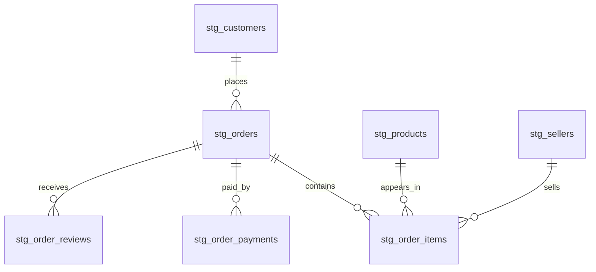

# Initial SQLite Model

The first database is a staging model: it mirrors the prepared source tables at their source grain. It is designed to validate and query source data before defining KPI-ready facts and dimensions.

## Tables and grain

| SQLite table | Grain | Primary key |
|---|---|---|
| `stg_customers` | One customer/order-level customer ID | `customer_id` |
| `stg_geolocation` | One distinct source geolocation row | Generated `geolocation_record_id` |
| `stg_products` | One product | `product_id` |
| `stg_sellers` | One seller | `seller_id` |
| `stg_category_translation` | One Portuguese category translation | `product_category_name` |
| `stg_orders` | One order | `order_id` |
| `stg_order_items` | One order item | (`order_id`, `order_item_id`) |
| `stg_order_payments` | One payment sequence within an order | (`order_id`, `payment_sequential`) |
| `stg_order_reviews` | One review source row | Generated `review_record_id` |

`review_id` is retained as a source field but is not a key because it repeats. Geolocation has a generated row key because postal-code prefixes repeat. The category translation table has no foreign key from products because two source categories are untranslated. Geolocation is kept independent because its postal-code prefixes are not unique.

The reporting views in `sql/04_powerbi_views.sql` provide one row per delivered order, one row per delivered item, and one row per delivered payment, plus two small aggregate summaries for import into Power BI.

## Relationships

## Scope limits

- Tables retain source columns and source-level records.
- No order-status filtering, deduplication beyond exact geolocation rows, KPI aggregation, or category translation is done in SQLite.
- Timestamp values are stored as ISO-formatted text and used as provided without timezone conversion; delivery timing compares calendar dates.
- `sql/01_create_schema.sql` defines the schema, `sql/04_powerbi_views.sql` defines reporting views, and `python -m commercepulse.load_sqlite` loads and checks the local database.
